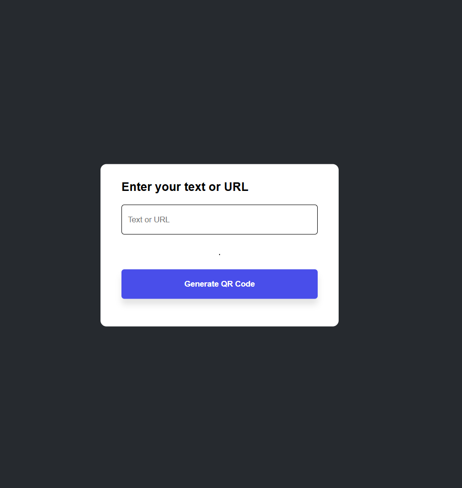
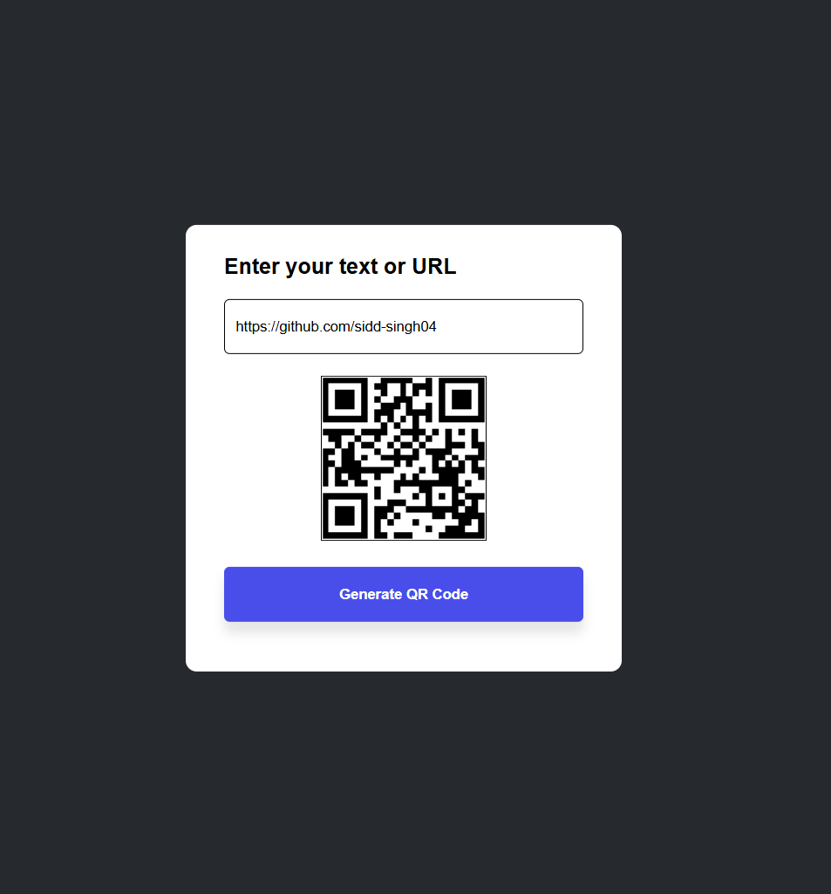

# QR Code Generator

> A simple and responsive web application to generate QR codes from text or URLs.

QR Code Generator is a lightweight web application built using **HTML, CSS, and JavaScript**. It allows users to enter text or a URL and instantly generate a corresponding QR code using the QR Server API.

---

## ✨ Features

* **Text & URL Support:** Generate QR codes from text or website URLs.
* **Instant Generation:** Create QR codes with a single click.
* **Simple Interface:** Clean layout with an easy-to-use input field and button.
* **Responsive Design:** Optimized styling for smaller screens.
* **API Integration:** Uses the QR Server API to generate QR code images.
* **Lightweight:** Built with HTML, CSS, and JavaScript without any frontend framework.

---

## 📸 Screenshots

### 1. QR Code Generator Interface

The main interface allows users to enter text or a URL before generating a QR code.

<p align="center">
  
</p>

### 2. Generated QR Code

Enter text or a URL and click the **Generate QR Code** button to display the corresponding QR code.

<p align="center">
  
</p>

---

## 🛠️ Tech Stack

| Technology    | Purpose                          |
| ------------- | -------------------------------- |
| HTML5         | Structure of the application     |
| CSS3          | Styling and responsive layout    |
| JavaScript    | QR code generation functionality |
| QR Server API | Generating QR code images        |

---

## ⚙️ How to Use

1. Clone the repository:

   ```bash
   git clone https://github.com/sidd-singh04/QR-Code-Generator.git
   ```

2. Open the project folder.

3. Open `index.html` in your browser.

4. Enter your text or URL in the input field.

5. Click **Generate QR Code**.

6. View the generated QR code in the application.

> An internet connection is required to load the QR code image from the external API.

---

## 🔗 API Reference

This project uses the QR Server API to generate QR code images.

**API Endpoint:**

`https://api.qrserver.com/v1/create-qr-code/`

The entered text or URL is passed to the API, which returns a QR code image.

---

## 🎯 Project Highlights

* Practiced DOM manipulation using JavaScript.
* Integrated an external API to generate QR codes dynamically.
* Designed a clean interface using CSS.
* Implemented responsive styling for smaller screens.
* Built a functional frontend project without external frameworks.

---

## 👨‍💻 Author

**Siddharth Singh**

GitHub: [@sidd-singh04](https://github.com/sidd-singh04)
